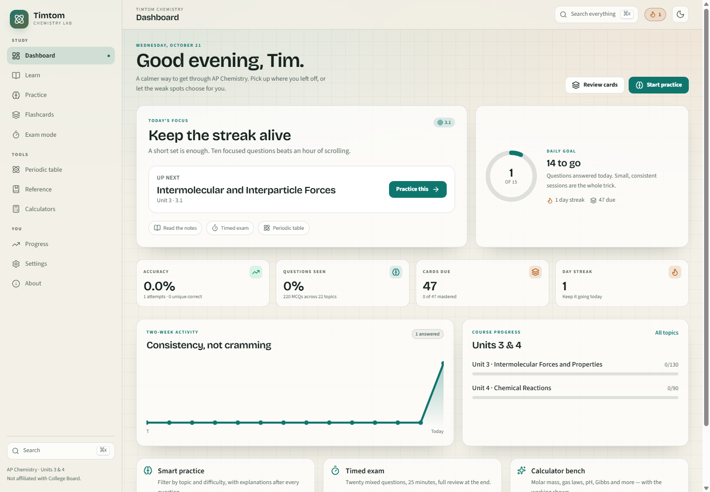
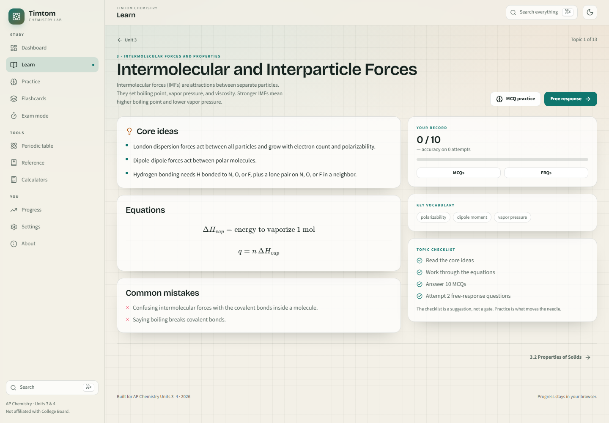
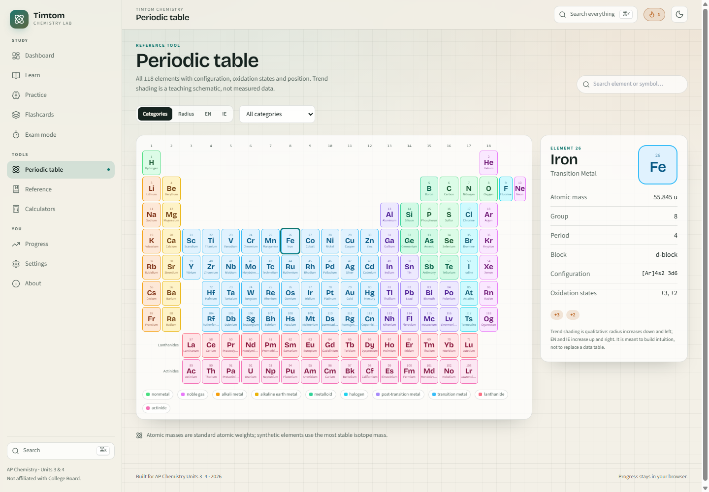
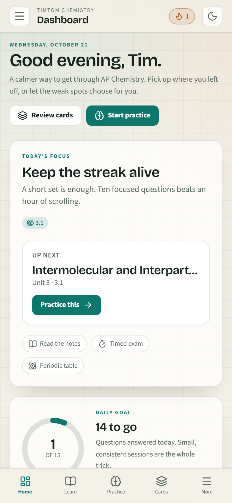
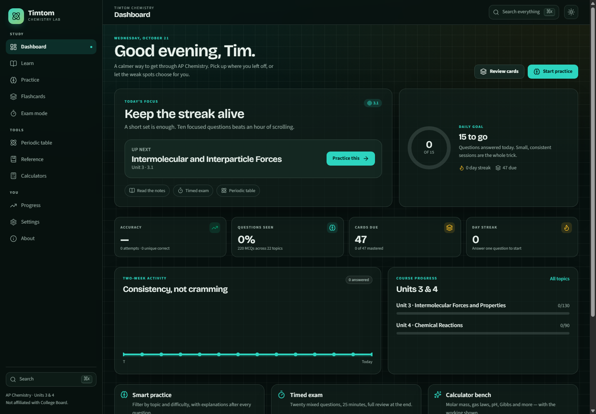

# Timtom Chemistry Lab

A focused AP Chemistry study workspace for **Units 3 and 4** — notes, 220 multiple-choice questions, 220 free-response questions, spaced-repetition flashcards, a full periodic table, twelve calculators and a timed exam mode.

> Not affiliated with or endorsed by College Board. AP is a trademark of the College Board.





<p align="center">
  
  
</p>

## Why this exists

Most chemistry revision sites are either a PDF with a search box or a gamified app that gets in the way. This is a single-page workspace built around three loops:

1. **Read** a short, structured topic page (core ideas → equations → vocabulary → common mistakes).
2. **Practise** with immediate explanations, filters and bookmarks.
3. **Review** on a spaced schedule, then test pacing in a timed exam.

Progress is stored in `localStorage`. No account, no server, no analytics.

## What's inside

| Area | Details |
| --- | --- |
| Learn | 22 topics across Units 3 & 4, each with concepts, equations, vocabulary and common mistakes |
| Practice | MCQ and FRQ sessions; filter by unit, topic, difficulty; instant or end-of-set feedback; optional timer; keyboard answers |
| Exam mode | 20 mixed MCQs in 25 minutes, navigator, per-unit breakdown and full review |
| Flashcards | Five-box Leitner schedule (1, 3, 7, 14, 30 days), keyboard flip and grading |
| Browse | Search every question and answer by text, unit or difficulty |
| Periodic table | All 118 elements, category colours, qualitative trend modes, element detail panel |
| Reference | Constants, gas laws, thermo, acid–base, kinetics, electrochemistry, solubility rules and ions, with copy-to-clipboard |
| Calculators | Molar mass (hydrates/nested groups), stoichiometry, limiting reactant, yield, gas law, pH, dilution, Gibbs, calorimetry, Beer–Lambert, half-life and photon energy |
| Progress | Accuracy by unit, topic and difficulty; 14-day activity; weak spots; exam history; bookmarks; JSON export/import |
| Search | `⌘K` / `Ctrl K` palette across pages, topics, questions, elements and formulas |
| Themes | Light “lab paper” and dark “bench” themes, reduced-motion setting |

## Stack

- Vite 5 + React 18 + TypeScript (strict)
- Tailwind CSS 3 + a small CSS design-token layer
- React Router 6 (hash routing, so it works on GitHub Pages under any repo name)
- Zustand with `persist` for local progress
- KaTeX + mhchem for chemistry notation
- Lucide icons
- Vitest for calculator/parser tests

## Getting started

```bash
npm install
npm run dev        # http://localhost:5173
npm run build      # typecheck + production build into dist/
npm run preview
npm test           # 16 logic tests
npm run validate   # content shape (10 MCQs + 10 FRQs per topic)
```

Node 20+ recommended.

## Content model

Content lives in `src/content/unitN.json` and is discovered with `import.meta.glob`, so a new `unit5.json` appears automatically.

```jsonc
{
  "unit": 3,
  "title": "Intermolecular Forces and Properties",
  "subunits": [
    {
      "id": "3.1",
      "title": "Intermolecular and Interparticle Forces",
      "summary": "…",
      "concepts": ["…"],
      "equations": ["\\Delta H_{vap}=…"],   // raw LaTeX, no $ delimiters needed
      "vocab": ["polarizability"],
      "mistakes": ["…"],
      "mcqs": [{ "id": "3.1-mcq-l1-001", "difficulty": 1, "question": "…", "choices": ["A. …"], "answer": "B", "explanation": "…" }],
      "frqs": [{ "id": "3.1-frq-l1-001", "difficulty": 1, "prompt": "…", "parts": [], "modelAnswer": "…" }],
      "cards": [{ "id": "3.1-c1", "front": "…", "back": "…" }]
    }
  ]
}
```

Run `npm run validate` before shipping — it checks every populated topic has 10 MCQs and 10 FRQs split two per difficulty level.

## Project layout

```
src/
  App.tsx                 routes
  index.css               design tokens, components, periodic table, flashcards
  components/
    layout.tsx            sidebar, topbar, mobile nav, command palette
    ui.tsx                Card, Button, Badge, Progress, Ring, Modal, Segmented…
    question.tsx          MCQ and FRQ renderers with grading
    charts.tsx            SVG sparkline and bar rows
    Tex.tsx               KaTeX inline/display renderer
  lib/
    content.ts            typed content index (questions, cards, topics)
    elements.ts           element data, formula parser, molar mass, positions
    calc.ts               pure calculator functions
    reference.ts          constants and formula sheet
    search.ts             palette index
    stats.ts              streak, coverage, weak spots, card scheduling
    store.ts              persisted Zustand store + legacy import
  pages/                  Dashboard, Learn, Practice, Exam, Flashcards, Browse,
                          Periodic, Reference, Calculators, Progress, Settings, About
scripts/validate.mjs      content validator
tests/logic.test.ts       parser, grading and calculator tests
```

## Privacy and data

- All study data lives in `localStorage` under `chemlab-v2`.
- Export a JSON backup from **Progress** or **Settings** before clearing site data.
- The previous version's key (`timtom-chem`) is imported automatically the first time you open the new app.
- No network requests are made for your data. Fonts are the only third-party asset.

## Deploy to GitHub Pages

1. Push to `main`.
2. **Settings → Pages → Build and deployment → Source: GitHub Actions**.
3. The workflow runs `npm ci`, content validation, tests, the production build, then deploys `dist`.

`vite.config.ts` uses `base: "./"` and the app uses `HashRouter`, so it works at `https://<user>.github.io/<repo>/` or on the custom domain in `CNAME` (`timtom-cem-help.com`).

## Accessibility & motion

- Skip link, focus-visible rings, labelled controls and radio-group semantics on answer choices.
- The command palette and dialogs close on `Esc`; the palette supports ↑/↓/Enter.
- “Reduce motion” (Settings) disables transitions and card flips; `prefers-reduced-motion` is respected.
- Mobile layout uses a bottom tab bar and a slide-over menu.

## Overhaul notes

This version is a ground-up rebuild of the original study tool:

- New visual system (lab-paper light theme, dark bench theme, responsive sidebar/mobile nav).
- Command palette and full-text question browser.
- Timed exam mode with per-unit breakdown and review.
- Spaced-repetition flashcards, bookmarks, streak and daily goal.
- Rebuilt periodic table with search, categories, trends and element detail.
- Twelve calculators with validation and visible working.
- Progress analytics by unit, topic and difficulty, plus JSON backup/restore.
- Content moved behind a typed index; added validator coverage and 16 unit tests.

## Disclaimer

Practice questions and explanations are original study material, not official AP questions, and have not been reviewed by College Board. Periodic trend shading is a qualitative teaching schematic, not measured data. Calculators assume ideal behaviour and the units shown; they do not choose significant figures for you.
